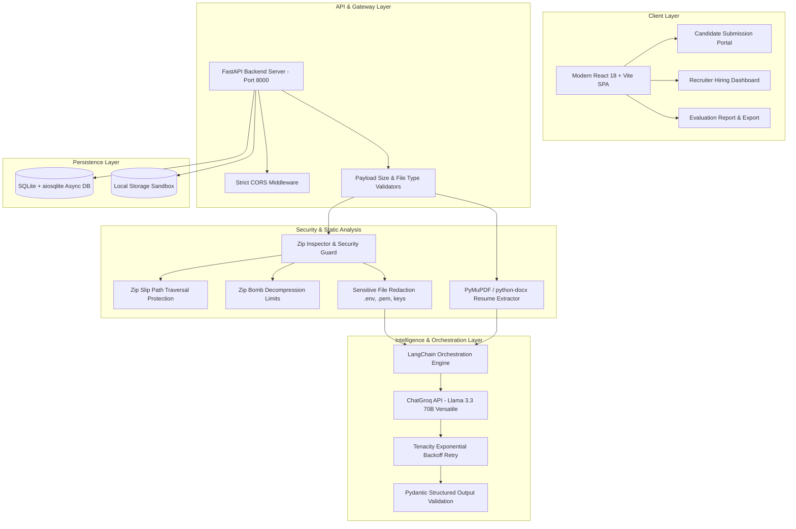

# Architecture & System Design
## Pine Labs Talent Intelligence Platform

### 1. High-Level Overview
The **Pine Labs Talent Intelligence Platform** is an enterprise-grade AI-assisted evaluation system designed for technical hiring teams. Candidates submit their resume (PDF/DOCX) alongside a ZIP archive containing a representative software project they have built. The platform securely parses, inspects, and analyzes these artifacts without ever executing unvetted code, generating an objective, evidence-based evaluation report and tailored interview questions.

---

### 2. Architecture Diagram

---

### 3. Pipeline Stages & Data Flow

1. **Upload & Multipart Validation (`/api/submissions`)**:
   - Accepts candidate profile information, resume file (up to 10MB), and project ZIP (up to 50MB).
   - Validates MIME types, magic numbers, and file extensions.
   - Generates unique reference IDs (e.g., `PL-2026-XXXXX`) and stores files in isolated disk partitions.

2. **Zip Security & Static Inspection (`app.services.zip_inspector`)**:
   - Inspects directory tree without writing untrusted files to executable directories.
   - Enforces **Zip Slip protection**: rejects any entry with `..`, absolute paths, or escaping drive letters.
   - Enforces **Zip Bomb protection**: tracks cumulative uncompressed bytes (< 200MB) and total entry count (< 5,000 files).
   - Excludes heavy artifact directories (`node_modules`, `.git`, `dist`, `target`, `venv`, `__pycache__`).
   - Automatically redacts sensitive files (`.env`, `.pem`, `id_rsa`, `*.key`, `credentials.json`).
   - Selects top key files (READMEs, dependency manifests, architectural files, core source files) up to context length constraints.

3. **Resume Parsing (`app.services.resume_parser`)**:
   - Extracts plain text from PDF via `fitz` (PyMuPDF) with multi-column reading order detection.
   - Extracts formatted paragraphs and tables from DOCX files via `docx`.
   - Produces clean text representation while tracking extraction quality warnings.

4. **Multi-Stage LLM Inference (`app.llm.chains`)**:
   - **Stage 1 (Resume Analysis)**: Extracts structured career timelines, claimed skills, programming languages, and projects with confidence levels.
   - **Stage 2 (Project Analysis)**: Analyzes project architecture, dependencies, frameworks, code organization, testing methodology, and security practices.
   - **Stage 3 (Synthesis & Triangulation)**: Reconciles claimed resume skills against actual repository code, generates 5-dimension rubric scores, highlights strengths with exact file citations, and produces deep, non-generic interview questions.

5. **Report Delivery & Recruiter UI**:
   - Live status polling via `/api/submissions/{id}/status`.
   - Full JSON and Markdown export for ATS integration.
   - Printable view with Pine Labs design tokens.

---

### 4. Architectural Trade-offs & Decisions

| Decision | Chosen Approach | Alternative Considered | Rationale |
|---|---|---|---|
| **Code Analysis Approach** | **Static AST & Content Inspection** | Dynamic Sandbox Execution (Docker/gVisor) | Arbitrary code execution of unknown candidate ZIPs presents severe RCE, crypto-mining, and malware hazards. Static inspection provides rich architectural signals while maintaining 100% security isolation. |
| **LLM Provider** | **Groq (`llama-3.3-70b-versatile`)** | OpenAI GPT-4 / Anthropic Claude | Ultra-fast inference latency (200-400ms per stage), cost effectiveness for batch hiring, and 128k context window support. |
| **Output Parsing** | **Custom JSON Extractor + Pydantic** | LangChain StructuredOutputParser | Standard OutputFixingParser can create extra roundtrips; a robust regex-delimited JSON extractor with Pydantic validation handles markdown fences gracefully. |
| **Database** | **SQLite with `aiosqlite`** | PostgreSQL | Zero external infrastructure dependency for running locally, full async support in FastAPI, easily swapped via `DATABASE_URL` for cloud environments. |
| **Frontend Framework** | **React 18 + Vite + Tailwind** | Next.js / Server Components | Fast client-side SPA with zero build friction, rapid local development, and clean component isolation. |
