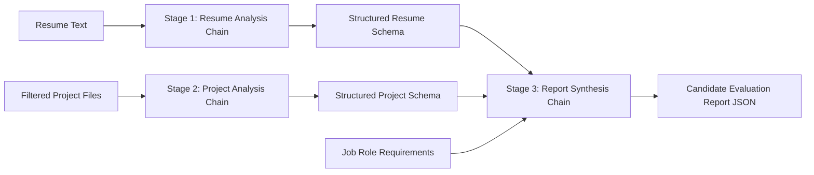

# LLM Chains & Prompt Engineering
## Pine Labs Talent Intelligence Platform

### 1. Chain Architecture
The evaluation pipeline divides technical evaluation into three isolated, purpose-built LLM chains to prevent hallucination, maximize context efficiency, and enable fine-grained error recovery:



---

### 2. Prompt Design Philosophy

1. **Grounded Evidence Over Speculation**:
   - Every claim must cite an exact file path, code snippet, or resume line.
   - Ambiguous claims receive `ConfidenceLevel.LOW` or `INSUFFICIENT`.
   - Never assume functionality exists if no evidence is present in the codebase.

2. **Defense Against Prompt Injection**:
   - Clear delimitation between instructions and candidate data.
   - Strict instructions to ignore meta-commands embedded in source code comments or READMEs.

3. **Rubric Objectivity**:
   - Standardized 10-point scale across 5 dimensions:
     1. Architecture & Design
     2. Code Quality & Idiomatic Implementation
     3. Concurrency, Fault Tolerance & Performance
     4. Security & Edge Case Handling
     5. Testing & Observability
   - Requires explicit listing of **Evidence** and **Missing Evidence** for every score.

4. **Actionable Interview Questions**:
   - Replaces generic questions ("Tell me about a time you solved a bug") with deep, codebase-grounded technical inquiries:
     - *Question*: What happens if Redis loses connection during `AcquireWithTTL`?
     - *Relevance*: Probes distributed lock failure modes.
     - *Prompted By*: Code in `pkg/idempotency/lock.go:L42`.
     - *Strong Answer Demonstrates*: Understanding of fencing tokens and fallback unique constraints.

---

### 3. Pydantic Output Validation & Resilience

- Model responses are parsed through `extract_json_from_response` to strip accidental markdown fences (` ```json `).
- Extracted JSON is validated against typed Pydantic models (`CandidateEvaluationReport`).
- The `tenacity` library provides 3-attempt exponential backoff retry on network timeouts or rate limits.
- If an LLM call fails, the system produces a structured fallback report with partial diagnostics rather than crashing the submission job.
